<div align="center">

# 🛡️ ElderGuard

### Privacy-Preserving Bathroom Fall Detection — No Cameras, No Wearables

**🎓 CSE Term One Project**


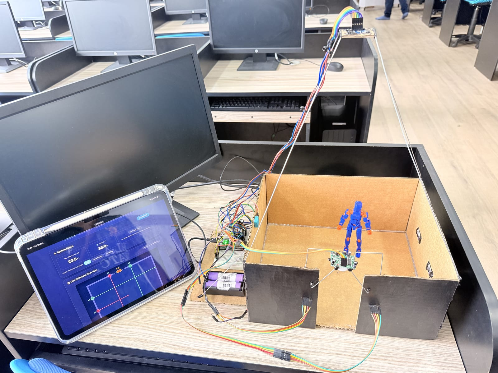

<sub>The working 1:12 scale prototype, with the live web dashboard running on a tablet.</sub>

</div>

---

## 📖 Table of Contents

- [The Problem](#-the-problem)
- [Why No Cameras?](#-why-no-cameras)
- [How ElderGuard Works](#-how-elderguard-works)
- [The Prototype](#-the-prototype)
- [Hardware](#-hardware)
- [Detection Logic](#-detection-logic)
- [A Fall, Step by Step](#-a-fall-step-by-step)
- [The LD2410C Radar's Role](#-the-ld2410c-radars-role)
- [Radar-First: The Real-Life Design](#-radar-first-the-real-life-design)
- [Live Web Dashboard](#-live-web-dashboard)
- [Repository Structure](#-repository-structure)
- [Getting Started](#-getting-started)
- [Troubleshooting](#-troubleshooting)
- [Prototype Constraints vs. Real-Life Deployment](#-prototype-constraints-vs-real-life-deployment)
- [Limitations & Future Work](#-limitations--future-work)
- [Team](#-team)

---

## 🚨 The Problem

Falls are one of the leading causes of injury among older adults, and the **bathroom is the most dangerous room in the house**: wet floors, hard surfaces, and getting in and out of the shower.

For an elderly person **living alone**, the fall itself is only half the danger. The other half is the *"long lie"*: lying on the floor for hours before anyone notices, which sharply worsens the outcome.

Existing solutions fail exactly where they are needed most:

| Solution | Why it fails in a bathroom |
|---|---|
| 📷 Security cameras | Unacceptable: a severe invasion of privacy and dignity |
| ⌚ Wearables / panic pendants | Taken off to shower, forgotten, or never pressed if the person is unconscious |
| 📞 Check-in phone calls | Hours can pass between calls |

**ElderGuard detects a fall automatically, using only sensors that cannot see a person, and needs nothing to be worn or pressed.**

---

## 🔒 Why No Cameras?

> **A bathroom is the one room where a camera can never be the answer.**

ElderGuard was designed from the ground up to be **camera-free**, and this is a core principle rather than a cost-saving shortcut:

- 🙈 **Dignity first.** People are undressed, showering and using the toilet in a bathroom. No one should have to trade their dignity for their safety. A system that records or streams images of this space would never be accepted by the people it is meant to protect.
- 🛡️ **Nothing to leak.** ElderGuard never captures an image, video or audio. Its sensors only report **distances, motion and humidity**. Even if the device were hacked, there would be no footage to steal.
- ⚖️ **Ethical and legal safety.** Images of people in a bathroom, especially health-related footage, are some of the most sensitive personal data possible. Not collecting them avoids that risk entirely.
- 🤝 **Real adoption.** A safety device only helps if it is switched on and trusted. Elderly users and their families are far more likely to accept a small sensor box than a camera.
- 🌫️ **Works where cameras struggle anyway.** Cameras are blinded by darkness and shower steam. ElderGuard's 24 GHz radar sees straight through steam.

**What the system "sees" is a set of numbers like** `N1: 150 mm [BLOCKED] · Radar: 24 cm, 88 % · RH: 85 %`. **That is enough to know someone has fallen, and nothing more.**

---

## ⚙️ How ElderGuard Works

No single low-cost sensor can reliably tell *"fell down"* apart from *"walked out"*, *"bent over"* or *"in a steamy shower"*. ElderGuard combines **four sensing methods**, each covering another's blind spots:

| | Sensor | Question it answers |
|---|---|---|
| 🟢 | **4× VL53L0X Time-of-Flight laser beams** | *Is someone upright?* Beams cross the room at torso height. A blocked beam means a person is standing in it. Every beam going clear after being blocked means a possible fall. |
| 🟠 | **PIR motion sensor** (doorway) | *Did someone enter or leave?* Wakes the system on entry, and recognises an exit so walking out is never mistaken for a fall. |
| 🔵 | **DHT11 humidity sensor** | *Is the shower running?* Steam scatters laser light, so high humidity switches the system into **shower mode**. |
| 🟣 | **HLK-LD2410C 24 GHz mmWave radar** | *Is the person still upright?* Radio waves pass straight through steam, so in shower mode the radar decides between "standing" and "on the floor". |

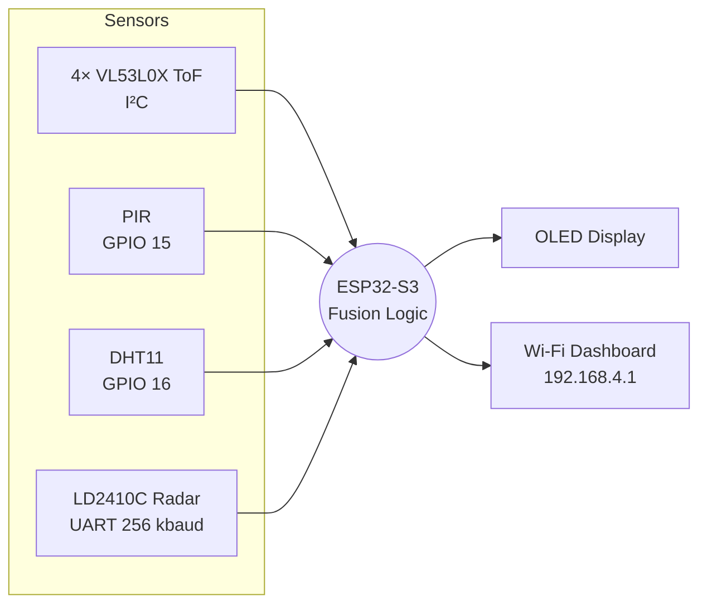

> 📡 **In a real bathroom, the radar does the heavy lifting.** In our 1:12 model the ToF beams had to lead, because the radar can't tell postures apart inside a 14 cm box. In a full-size installation the roles flip: **the overhead radar carries roughly 90 % of the detection logic**, and the ToF beams, PIR and humidity sensor become supporting, confirming sensors. See [Radar-First: The Real-Life Design](#-radar-first-the-real-life-design).

---

## 🏠 The Prototype

The design was built and tested as a **1:12 scale bathroom**: a 30 × 25 × 14 cm cardboard enclosure with a doorway, and a ~14 cm action figure standing in for a person.

<table>
<tr>
<td width="50%">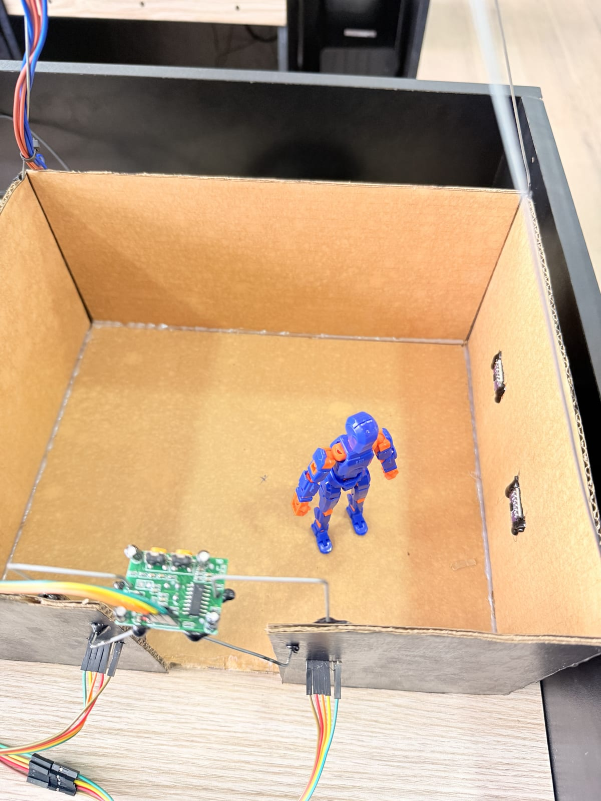<br><sub><b>Standing:</b> the figure's torso blocks a ToF beam, so the system shows <code>STANDING</code>.</sub></td>
<td width="50%">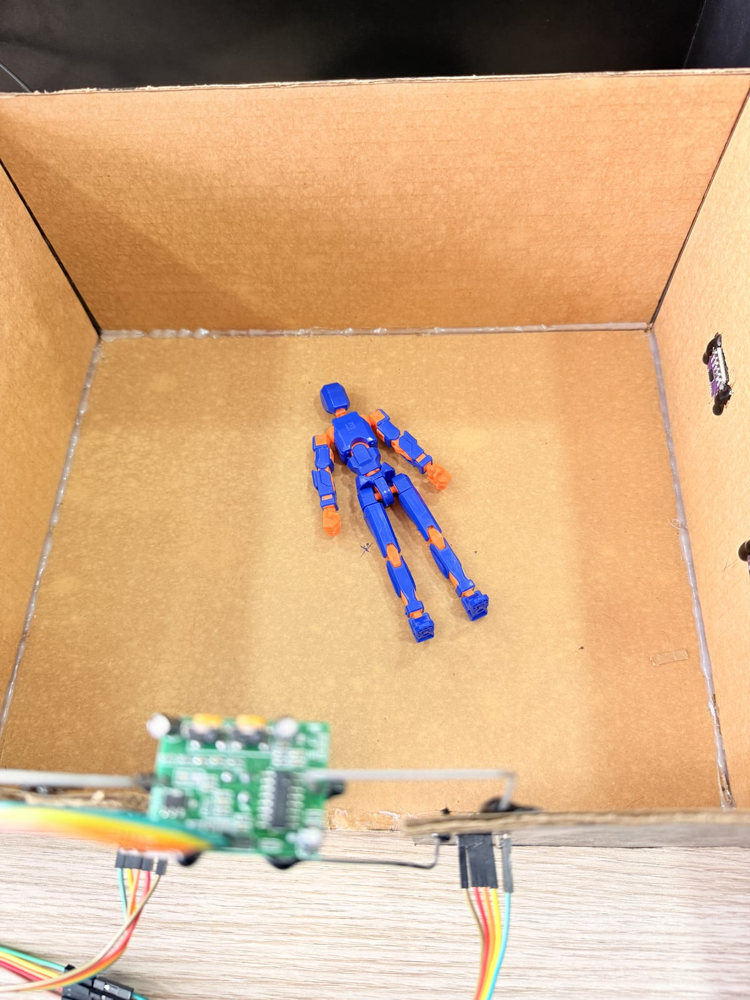<br><sub><b>Fallen:</b> every beam clears and stays clear, so after the confirmation timer the system raises <code>FALL!</code></sub></td>
</tr>
<tr>
<td>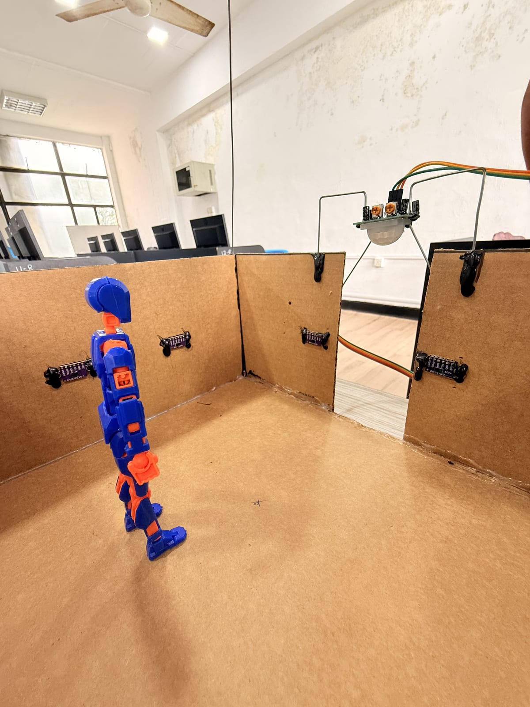<br><sub>Inside view: VL53L0X sensors mounted on the walls at waist height, with the PIR above the doorway.</sub></td>
<td>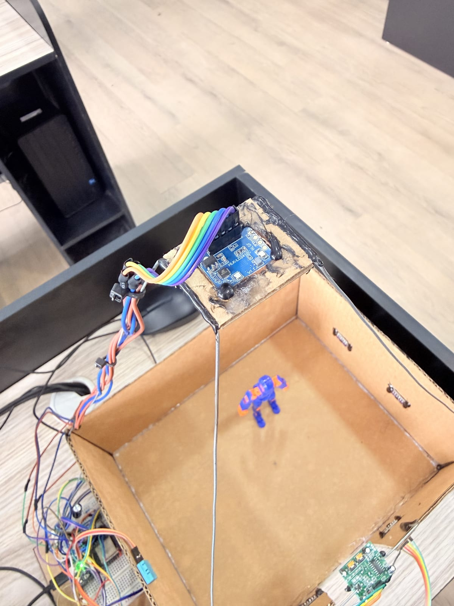<br><sub>The LD2410C radar mounted overhead on a wire arm, facing straight down into the room.</sub></td>
</tr>
<tr>
<td>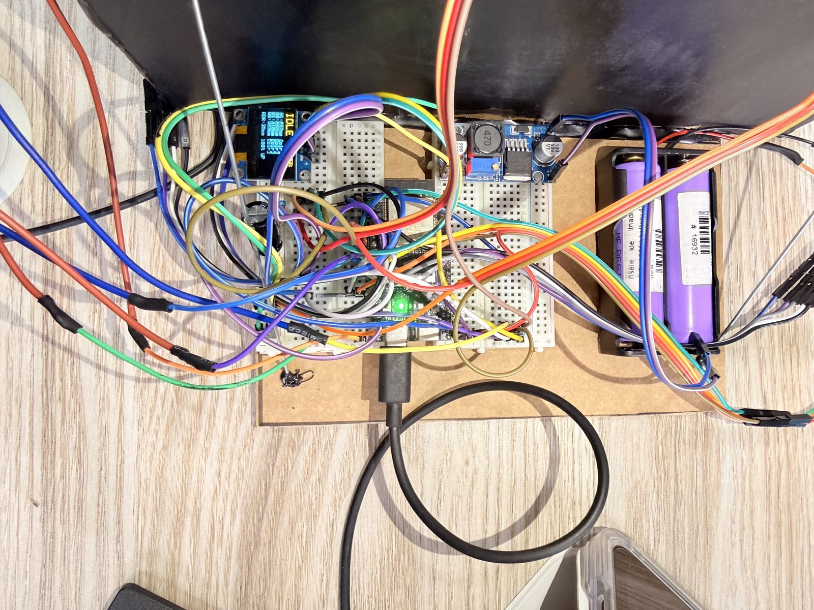<br><sub>The electronics: ESP32-S3, OLED status display, 5 V buck converter and 2× 18650 cells.</sub></td>
<td>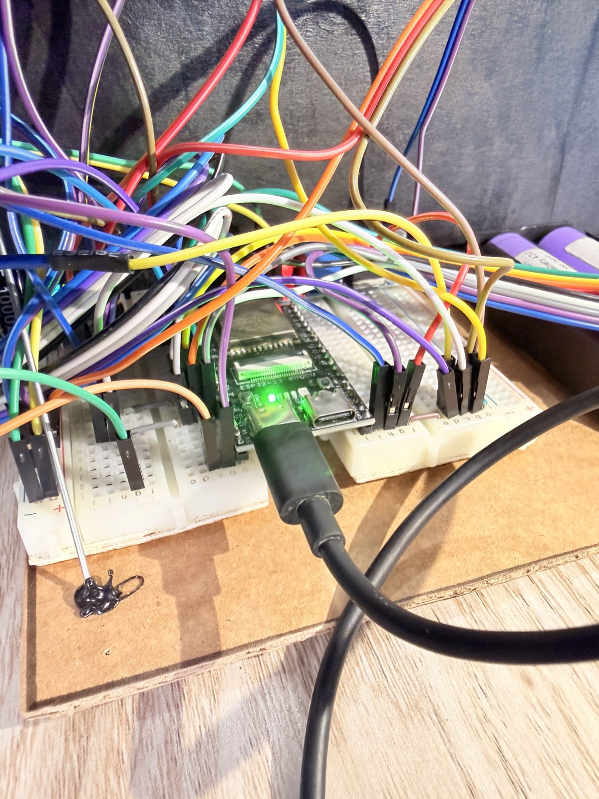<br><sub>Close-up of the ESP32-S3 DevKit that runs the fusion logic and web server.</sub></td>
</tr>
</table>

**Sensor layout (top view):**

```
            N1        PIR (doorway)        N2
        ┌────┼──────────[====]──────────────┼────┐
        │    ┆                              ┆    │
   W1 ──┼┄┄┄┄┼┄┄┄┄┄┄┄┄┄┄┄┄┄┄┄┄┄┄┄┄┄┄┄┄┄┄┄┄┄┼┄┄┄┄│
        │    ┆            (radar ↓)         ┆    │
        │    ┆                              ┆    │
   W2 ──┼┄┄┄┄┼┄┄┄┄┄┄┄┄┄┄┄┄┄┄┄┄┄┄┄┄┄┄┄┄┄┄┄┄┄┼┄┄┄┄│
        │    ┆                              ┆    │
        └────┴──────────────────────────────┴────┘
          30 × 25 cm floor · beams at 6.8–7 cm height
```

---

## 🔧 Hardware

| Component | Qty | Role |
|---|:-:|---|
| **ESP32-S3 DevKitC-1** | 1 | Main controller. Reads every sensor, runs the detection logic and hosts the Wi-Fi dashboard as its own access point. |
| **VL53L0X ToF breakout** (GY-VL53L0XV2) | 4 | Laser distance "beams" across the room. Each gets a unique I²C address at boot via its XSHUT pin. |
| **PIR motion sensor** (HC-SR501) | 1 | Doorway entry/exit detection. |
| **DHT11** | 1 | Temperature and relative humidity, used to switch into shower mode. |
| **HLK-LD2410C** | 1 | 24 GHz mmWave presence radar, mounted overhead. |
| **SSD1306 0.96" OLED** (I²C) | 1 | Local status display. |
| **2× 18650 Li-ion + DC-DC buck converter** | 1 set | Power supply, stepped down to a clean 5 V. |

### 📌 Pin Map (ESP32-S3)

| Signal | GPIO | Notes |
|---|:-:|---|
| I²C SDA / SCL | **8 / 9** | Shared by all 4 ToF sensors + OLED |
| ToF XSHUT N1 / N2 / W1 / W2 | **4 / 5 / 6 / 7** | Addresses assigned 0x30–0x33 at boot |
| PIR output | **15** | Digital input |
| DHT11 data | **16** | 10 kΩ pull-up recommended |
| Radar TX → ESP32 RX1 | **17** | 256 000 baud |
| ESP32 TX1 → Radar RX | **18** | |
| OLED address | — | 0x3C |

> ⚡ The LD2410C **must be powered from 5 V**, not 3.3 V. All grounds (battery, buck converter, ESP32, every sensor) share a common ground.

---

## 🧠 Detection Logic

ElderGuard runs a state machine that only declares a fall when a specific **fall signature** is seen:

> 1️⃣ someone was upright → 2️⃣ every beam clears → 3️⃣ they stay clear for the confirmation time (default 5 s) → 4️⃣ nobody walked out of the door

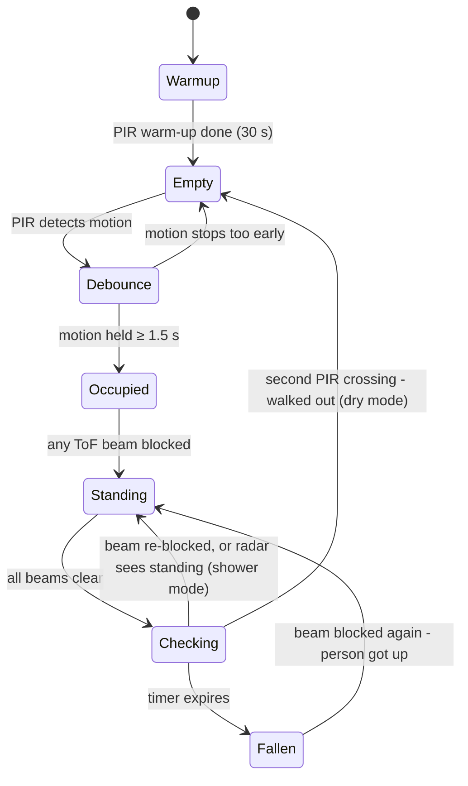

### 💧 Dry Mode vs. 🚿 Shower Mode

| | **Dry mode** (humidity below threshold) | **Shower mode** (humidity above threshold) |
|---|---|---|
| **Primary judge** | ToF laser beams | LD2410C radar |
| **All beams clear** | Start the fall timer | Ask the radar |
| **Cancel the timer when…** | a beam is blocked again, **or** the PIR sees the person leave | a beam is blocked again, **or** the radar still sees a torso at standing height (the person is just hidden by steam) |
| **Confirm a fall when…** | the timer expires with no exit | the timer expires and the radar sees no one, or only at floor level |

### 🛠️ Built for Reliability

Testing showed that cheap sensors are noisy, so the firmware is hardened against false alarms:

| Technique | What it does |
|---|---|
| **Hysteresis** | A beam becomes "blocked" 15 mm below its baseline, but only returns to "clear" within 5 mm of it, so a reading sitting on the edge can't flicker. |
| **2-sample debounce** | A beam's state must repeat on 2 consecutive readings before it changes. One noisy reflection can't start a false alarm. |
| **Exit debounce** | The doorway exit signal must persist for the debounce time, so a brief PIR blip can't hide a real fall. |
| **Close-range handling** | An object pressed right against a ToF sensor (inside its ~30 mm minimum range) counts as *blocked*, not *clear*. |
| **Sensor health checks** | A ToF sensor that fails at boot is flagged as `[FAIL]` on the OLED and dashboard, excluded from decisions, and automatically retried every 10 s. |
| **Validated settings** | Every value received from the dashboard is range-checked on the device before it is applied or saved. |

---

## 🎬 A Fall, Step by Step

Here is what the live dashboard showed during a real test in the prototype, from a person standing to a confirmed fall.

<table>
<tr>
<td width="50%" valign="top">

**① Standing**

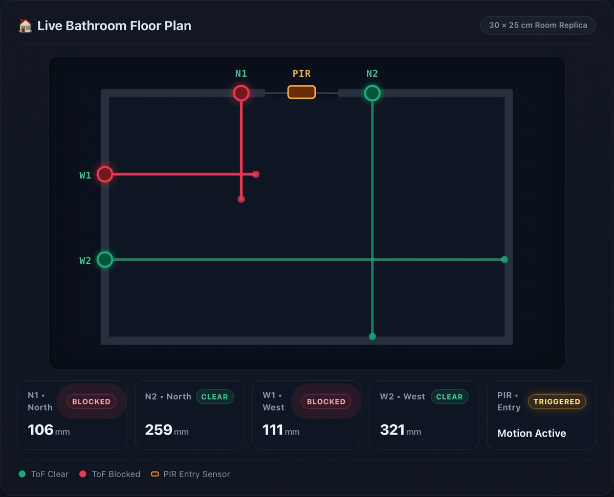

The figure stands where beams **N1** and **W1** cross. Both turn **red and shorten** to where they hit the body (106 mm and 111 mm, instead of the empty-room ~250 mm and ~300 mm). The PIR shows the entry was detected.

</td>
<td width="50%" valign="top">

**② The figure falls, and every beam clears**

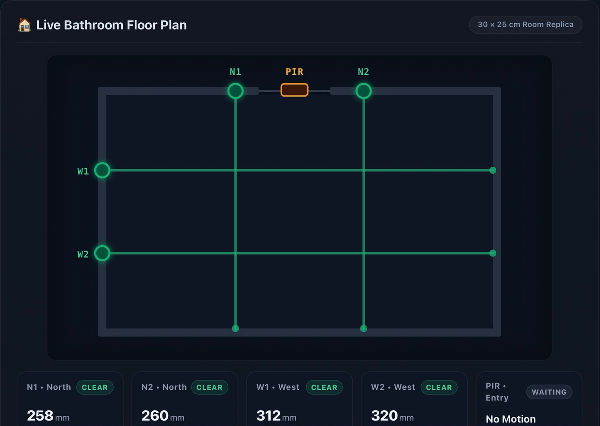

The figure drops below the 7 cm beam height. All four beams return to their full empty-room length, which is the first part of the **fall signature**.

</td>
</tr>
<tr>
<td width="50%" valign="top">

**③ Checking: the confirmation timer runs**

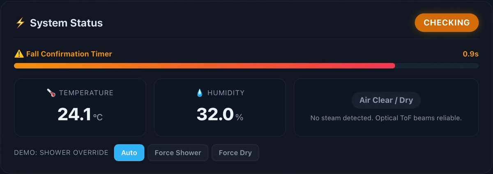

The status switches to **CHECKING** and the fall confirmation bar counts down (0.9 s left here). If any beam is blocked again, or the person walks out of the door, the check is cancelled.

</td>
<td width="50%" valign="top">

**④ Fall confirmed**

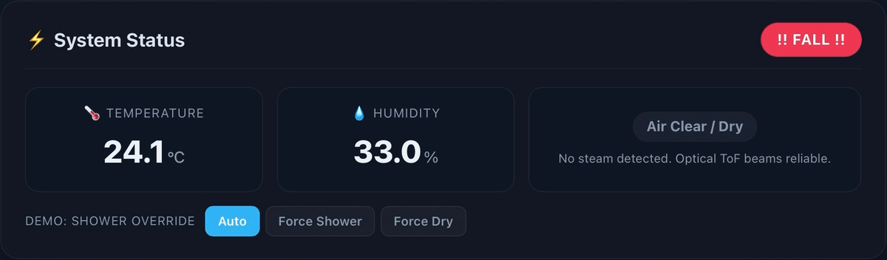

Nothing cancelled the timer, so the system raises **!! FALL !!** on the dashboard and the OLED, and logs the event. It stays in this state until someone stands up and blocks a beam again.

</td>
</tr>
</table>

---

## 📡 The LD2410C Radar's Role

The **HLK-LD2410C** is a small 24 GHz mmWave presence radar. In the prototype it acts as the **tie-breaker when steam makes the laser beams unreliable**. In a real installation it becomes the **main sensor** (see [the next section](#-radar-first-the-real-life-design)).

- ✅ It reports **whether a person is present**, even someone sitting perfectly still, detected from their breathing.
- 📏 It reports **how far that person is from the radar** and how strong the reflection is.
- 🌫️ It **keeps working in steam**, darkness and heat.
- 🔒 It **never captures an image**.

Because it is **mounted overhead, facing down**, a short distance means the target is *high up* (standing), and a long distance means *low* (on the floor). The firmware treats the radar as **"sees standing"** only when:

```
person detected  AND  reflection strength ≥ 8 %  AND  distance from radar ≤ 40 cm
```

The radar is configured once using the **HLKRadarTool** phone app (0.20 m distance gates, per-gate sensitivity and range limit), then streams readings to the ESP32 about 10 times per second. The firmware decodes the radar's data frames directly, without an external library.

**The radar on the live dashboard:**

<table>
<tr>
<td width="50%" valign="top">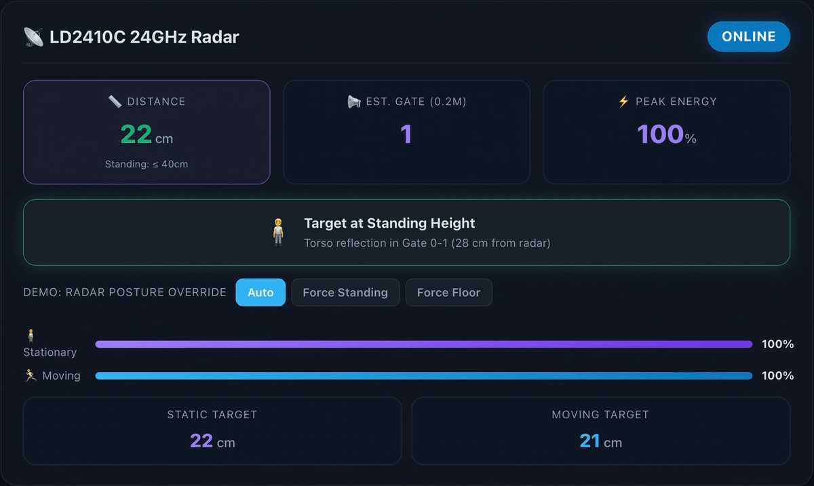<br><sub><b>Standing:</b> the target is <b>22 cm</b> from the radar, inside the ≤ 40 cm standing zone (distance shown in green), so the posture card reads <b>Target at Standing Height</b>.</sub></td>
<td width="50%" valign="top">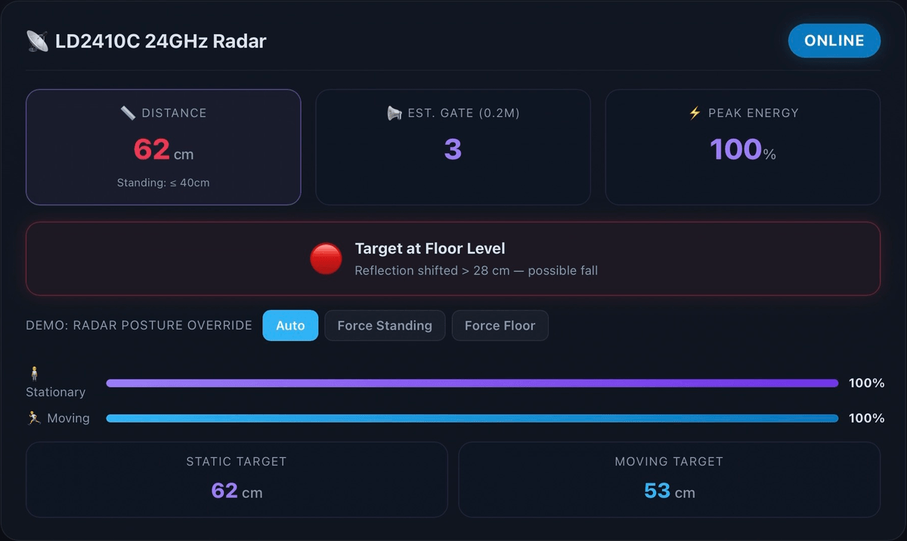<br><sub><b>On the floor:</b> the target is now <b>62 cm</b> away, beyond the standing zone (distance shown in red), so the card reads <b>Target at Floor Level — possible fall</b>.</sub></td>
</tr>
</table>

---

## 🎯 Radar-First: The Real-Life Design

> **In a real home, ElderGuard would be a radar-first system: the overhead mmWave radar carries roughly 90 % of the detection logic, and the other sensors act as supporting, confirming sensors.**

In the 1:12 model, the ToF beams had to be the primary judge. That was purely a consequence of scale: inside a 14 cm tall box, "standing" and "fallen" are only a few centimetres apart, smaller than one 20 cm radar distance gate. In a full-size bathroom those positions are **more than a metre apart**, and the radar becomes by far the most capable sensor in the system.

| Detection task | 📡 Radar (primary) | Supporting sensors |
|---|---|---|
| **Is anyone in the room?** | Sees anyone in its cone, moving *or* perfectly still (from breathing) | PIR confirms entries and exits at the door |
| **What posture are they in?** | Measures torso distance from the ceiling: standing ≈ 1.0 m, sitting ≈ 1.5 m, on the floor ≈ 2.3 m | ToF beams give a second opinion at fixed heights |
| **Did they fall?** | A fast drop in distance with a burst of movement, then stillness at floor distance | All beams clearing confirms the fall |
| **Are they still breathing / responsive?** | Detects breathing micro-motion even when the person is motionless | *No other sensor here can do this* |
| **Is the shower on?** | Unaffected by steam, works the same either way | DHT11 flags shower mode so the laser beams are trusted less |

**Why the radar can take the lead:**

- 🏠 **Whole-room coverage from one point:** a single ceiling unit covers the floor area that would otherwise need many thin laser beams.
- 🌫️ **Steam-proof:** it works the same with the shower running, which is exactly when falls are most likely.
- 🫁 **Detects still people:** a person lying unconscious is still detected from their breathing. A PIR would see nothing.
- 📏 **Clear posture separation:** standing, sitting and lying are separated by metres, not centimetres, so the decision is unambiguous.
- 🔒 **Fully private:** no image is ever formed.

**Why we would still keep the other sensors:**

- ✅ **Fewer false alarms:** an alert can require two independent sensors to agree (for example radar sees a fall *and* the beams clear).
- 🚪 **Doorway logic:** the PIR cleanly separates "left the room" from "disappeared from view".
- 🛟 **Fallback:** if the radar faults or is obstructed, the beams still provide basic fall detection, and the dashboard flags the fault.

---

## 📊 Live Web Dashboard

The ESP32 creates its own Wi-Fi network, so **no router, app or internet connection is needed**. Connect a phone or laptop and open **`http://192.168.4.1`** (shown running on the tablet in the photo at the top of this page).

**Features**

- 🗺️ **Live floor plan:** each ToF beam turns red and shortens to where it is blocked.
- 📡 **Radar card:** distance, gate, signal energy and standing/floor posture in real time, with a green/red cue against the standing threshold.
- 🌡️ **Environment:** temperature, humidity and shower-mode status.
- ⏱️ **Fall countdown bar** while the system is checking a possible fall.
- ⚙️ **Adjustable settings**, saved to flash so no re-programming is needed.
- 🔴 **"Connection lost" banner** if the device stops responding, so stale data is never mistaken for "all clear".
- 📜 **Recent events log** of falls, recoveries and test alerts.
- 🎬 **Demo controls:** clearly labelled overrides to force shower mode or the radar's posture, for reliable live demonstrations.

### Adjustable Settings

| Setting | Default | Range |
|---|:-:|:-:|
| PIR warm-up time | 30 s | 5–60 s |
| PIR doorway debounce | 1.5 s | 0.5–5 s |
| Fall confirmation timer | 5 s | 1–15 s |
| Shower humidity threshold | 82 % RH | 70–95 % (UI) |

### REST API

| Endpoint | Method | Purpose |
|---|:-:|---|
| `/` | GET | Dashboard page |
| `/api/status` | GET | Live JSON: state, beams, sensor health, humidity, radar data |
| `/api/settings` | GET / POST | Read or update the settings above |
| `/api/test_alert` | POST | Trigger a test alert |
| `/api/shower_override` | POST | Demo: `{"mode":"auto"\|"on"\|"off"}` |
| `/api/radar_override` | POST | Demo: `{"mode":"auto"\|"standing"\|"floor"}` |

---

## 🗂️ Repository Structure

```
ElderGuard/
├── firmware/
│   └── ElderGuard/
│       ├── ElderGuard.ino   # Sensor fusion, state machine, web server, OLED
│       └── index2.h         # Live dashboard (HTML/CSS/JS), served from flash
├── docs/
│   └── images/              # Prototype photos and dashboard screenshots
└── README.md
```

The whole system is a single Arduino sketch: open `ElderGuard.ino` and the dashboard file `index2.h` loads with it automatically.

---

## 🚀 Getting Started

### 1. Install the tools

1. Install the [Arduino IDE](https://www.arduino.cc/en/software).
2. Add ESP32 support: **Boards Manager → search "esp32" by Espressif → Install**.
3. Install these libraries from **Tools → Manage Libraries**:

| Library | Author |
|---|---|
| Adafruit VL53L0X | Adafruit |
| Adafruit GFX Library | Adafruit |
| Adafruit SSD1306 | Adafruit |
| DHT sensor library *(+ Adafruit Unified Sensor)* | Adafruit |
| ArduinoJson (v7.x) | Benoit Blanchon |

### 2. Flash the firmware

1. Open `firmware/ElderGuard/ElderGuard.ino` (`index2.h`, the dashboard page, opens alongside it as a tab).
2. Select **Tools → Board → ESP32S3 Dev Module** and your COM port.
3. Click **Upload**.

### 3. Configure the radar (once)

Using the **HLKRadarTool** app (Bluetooth, default password `HiLink`), set the distance resolution to **0.20 m** and tune the per-gate thresholds for your mounting height.

### 4. Connect

1. Join the Wi-Fi network **`ElderGuard`** (password `elderguard123`).
2. Open **`http://192.168.4.1`**.
3. After the 30 s PIR warm-up, the system is live.

> 🔐 **Change the default Wi-Fi password** in `ElderGuard.ino` (`ap_password`) before deploying anywhere real.

---

## 🩺 Troubleshooting

Open the Arduino **Serial Monitor at 115200 baud**. The firmware logs every state change and sensor problem.

| Symptom | Likely cause & fix |
|---|---|
| Serial shows `SSD1306 failed` and nothing happens | The OLED wasn't found on I²C. Check SDA → GPIO 8, SCL → GPIO 9 and address `0x3C`. The firmware stops at boot without it. |
| A beam shows `[FAIL]` on the OLED / dashboard | That ToF sensor didn't respond at boot. Check its power, I²C wires and XSHUT pin. It is retried every 10 s, and Serial prints `… recovered — back online.` once it works. |
| Radar card says **OFFLINE** | No radar frame for over 1 s. Check the radar has **5 V** (not 3.3 V), radar TX → GPIO 17, radar RX → GPIO 18. |
| `[DHT11] Read failed (NaN)` | Check the data wire on GPIO 16 and the 10 kΩ pull-up resistor. |
| Humidity reads unrealistically high or low | DHT11 units vary a lot. Adjust `DHT_RH_CAL_OFFSET` in `ElderGuard.ino` to match a reference reading. |
| Stuck on **EMPTY**, PIR never triggers | Wait out the 30 s warm-up, then move through the doorway. PIR sensors detect *movement*, not a still hand. Check GPIO 15 and the PIR's supply voltage. |
| Dashboard shows **Connection Lost** | Your device left the `ElderGuard` Wi-Fi network or the ESP32 restarted. Reconnect and the banner clears on the next update. |
| Saving settings shows *flash write error* | The values apply for the current session but weren't saved, so they reset on reboot. Try again; if it persists, re-flash the firmware. |

---

## 📐 Prototype Constraints vs. Real-Life Deployment

Building at 1:12 scale proved the logic, but it introduced problems that **come from the scale, not from the design**. All the sensors are full-size hardware made for real rooms. Only the room and the "person" were shrunk. **In a real bathroom, most of these constraints disappear.**

| Sensor | ❌ Constraint in the 1:12 model | ✅ In a real bathroom |
|---|---|---|
| **LD2410C radar** | The smallest distance gate (20 cm) is taller than the whole 14 cm box, so standing and fallen positions are less than one gate apart. A plastic figure barely reflects radar at all. | With a ~2.5 m ceiling, a standing torso is ~1.0 m from the radar and a fallen person ~2.3 m away. That is over 1.2 m apart, about **6 gates**, so the decision is clear-cut. A human body (mostly water) reflects radar strongly, and breathing gives a steady signal. |
| **VL53L0X ToF** | A 25° beam spreads to 11–13 cm, almost as wide as the figure. The ~30 mm minimum range and close walls cause reflections. Only 4 thin beams cover a tiny floor. | Beams at ~80–100 cm across a 1.5–2 m room sit well inside the ~2 m range. A person is far wider than the beam, and more beams can be added cheaply. |
| **PIR** | Rated for 3–7 m, but the model's doorway is only centimetres away. A small hand movement is a weak signal. | A real doorway 1–3 m from the sensor is inside the rated range, and a whole person walking through is a strong, reliable signal. |
| **DHT11** | ±5 % accuracy (this unit read ~28 % high and needed a calibration offset). Real shower steam can't be produced on demand inside a cardboard box. | A real hot shower pushes humidity above 90 %, comfortably past the threshold. An SHT31 (±2 %) is a drop-in upgrade. |
| **Test subject** | A 14 cm figure is lighter, smaller and less reflective than a person, and falls differently. | A real person is exactly what every sensor was designed to detect. |

> 💡 **Same hardware, same building blocks.** Moving to a real room means re-tuning mounting heights and thresholds (most of which are already adjustable from the dashboard) and **promoting the radar from tie-breaker to primary sensor**, as described in [Radar-First: The Real-Life Design](#-radar-first-the-real-life-design).

---

## 🔭 Limitations & Future Work

- 📲 **Caregiver alerts over the internet:** join the home Wi-Fi and send a WhatsApp/Telegram message when a fall is confirmed. The firmware already has the alert hook.
- 🪑 **Sitting vs. falling:** add a third radar zone (standing / sitting / floor) using the speed of the drop and the final height, plus a beam covering the commode area. This difference is too small to measure in the scale model, but is around 0.7 m in a real room.
- 🔔 **Local alarm** with an "I'm OK" cancel button and an SOS button.
- 🎯 **VL53L5CX 8×8 multi-zone ToF** mounted overhead to measure body height directly.
- 📈 **Activity history:** bathroom visit counts and durations as long-term health indicators.
- 🧪 **Full-size room trial** to tune thresholds with real people.

---

## 👥 Team

ElderGuard was built as a team for the **CSE Term One Project**.

<table>
<tr>
<td align="center" width="20%"><a href="https://github.com/Mint847"><br><b>Seniru Minthaka</b></a><br><sub>@Mint847</sub></td>
<td align="center" width="20%"><a href="https://github.com/vidushanimsara50-beep"><br><b>Vidusha</b></a><br><sub>@vidushanimsara50-beep</sub></td>
<td align="center" width="20%"><a href="https://github.com/afham-md"><br><b>Afham</b></a><br><sub>@afham-md</sub></td>
<td align="center" width="20%"><a href="https://github.com/umarfahmymw-collab"><br><b>Umar Fahmy</b></a><br><sub>@umarfahmymw-collab</sub></td>
<td align="center" width="20%"><a href="https://github.com/sulaimanmohamed3391-dotcom"><br><b>Sulaiman</b></a><br><sub>@sulaimanmohamed3391-dotcom</sub></td>
</tr>
</table>

---

<div align="center">

**ElderGuard** · 🎓 *CSE Term One Project*

*Safety without surveillance.*

</div>
